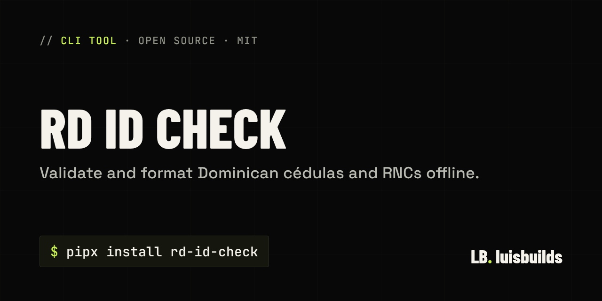

<p align="center"></p>

<h1 align="center">RD ID Check</h1>

<p align="center"><b>Valida y da formato a cédulas y RNC dominicanos sin conexión.</b></p>

<p align="center"><a href="README.md">🇬🇧 English</a> · <a href="https://luisbuilds.com/h/rd-id-check">Guía paso a paso</a></p>

---

RD ID Check valida y da formato a cédulas dominicanas (11 dígitos) y a RNC (9 dígitos) sin necesidad de conexión a internet. Es una herramienta de línea de comandos y una biblioteca de Python, pensada para desarrolladores y para quien revisa listas de clientes o proveedores.


## Qué hace

- Validación sin conexión con python-stdnum, incluidas las excepciones oficiales
- Acepta números con espacios, guiones o puntos
- Da formato a cédulas y RNC como los escribe la DGII
- Validación por lotes desde un archivo de texto en UTF-8
- Salida en JSON para tus scripts
- Mensajes en español que explican por qué un número no es válido


## Instalación


```bash
pipx install rd-id-check
```

¿No tienes `pipx`? También vale `pip install rd-id-check`. Necesitas Python 3.10 o superior en Windows, macOS o Linux. Si nunca has instalado Python, la [guía paso a paso](https://luisbuilds.com/h/rd-id-check) te lleva de cero.

## Uso

Valida una cédula y un RNC a la vez:

```console
$ rd-id-check 00113918205 401506254
```

Obtén JSON para tus scripts:

```console
$ rd-id-check --json 401-50625-4
```

Valida una lista entera (sale con 1 si alguno es inválido):

```console
$ rd-id-check --file clientes.txt
```

Ejecuta `rd-id-check --help` para ver todas las opciones.


## Preguntas frecuentes

**¿Necesita internet o envía mis números a algún lado?**
No. Funciona sin conexión a internet.

**¿Cómo sé si un número es cédula o RNC?**
Por su longitud: 11 dígitos es una cédula y 9 dígitos es un RNC. Los espacios, guiones y puntos se ignoran.

**¿Qué no verifica?**
No confirma que una persona o empresa exista o esté activa, lo cual requiere los servicios en línea de la DGII o la JCE. Tampoco maneja pasaportes, documentos de identidad extranjeros ni comprobantes NCF o e-CF.


## Soporte

Se publica **tal cual**, gratis y de código abierto, sin soporte garantizado. Si encuentras un problema de seguridad, avísame en privado (ver [SECURITY.md](SECURITY.md)).

Si te ahorró tiempo, puedes [apoyar mi trabajo](https://github.com/sponsors/luisbuilds-dev) ❤️

---

<p align="center">Hecho por <a href="https://luisbuilds.com">Luis Cabrera</a> · <a href="LICENSE">Licencia MIT</a></p>
